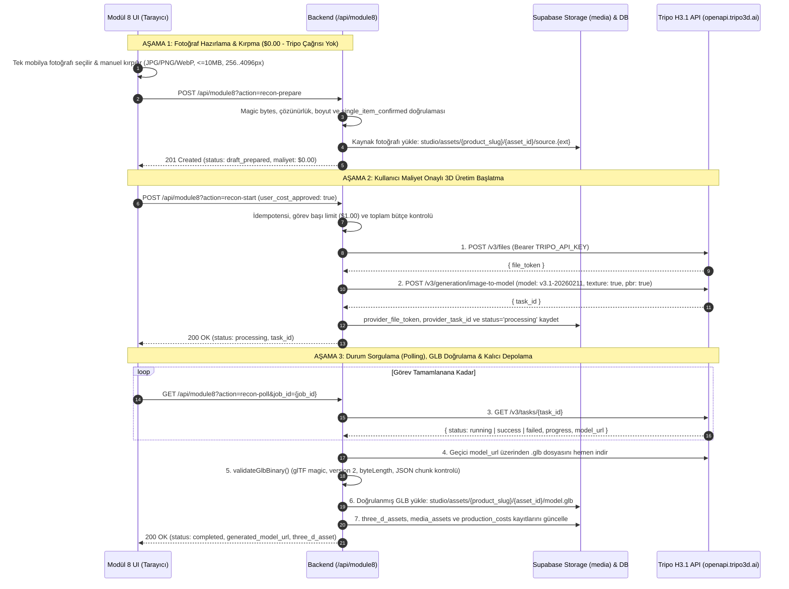

# GLOBAL MOBİLYA — MODULE 8.1: AI ASSET RECONSTRUCTION ENGINE REPORT
## Phase 1 — Tripo H3.1 (`v3.1-20260211`) Single-Product 3D Reconstruction Integration

**Rapor Tarihi:** 9 Kasım 2026  
**Modül:** Modül 8.1 — Creative Production Studio / AI Asset Reconstruction Engine  
**AI Sağlayıcı & Model:** Tripo 3D Official API (`https://openapi.tripo3d.ai`) — `model: v3.1-20260211`  
**Canlı Sunucu / Ücretli API Çağrısı:** Yapılmadı (`$0.00` maliyet, %100 deterministik mock test doğrulaması)

---

## 1. İncelenen Mevcut Dosyalar ve Mimari Koruma

Geliştirme öncesinde aşağıdaki mevcut bileşenler incelenmiş ve hiçbir regresyon oluşturmadan genişletilmiştir:

- **[api/module8.js](file:///C:/Users/User/Desktop/Insta_Deployment/api/module8.js):** Mevcut `overview`, `media`, `upload`, `jobs`, `job-detail`, `job-retry`, `job-cancel`, `worker` (`claim`, `update`, `complete`, `fail`), `3d-assets`, `scene-templates`, `engines` ve `catalog-ref` uç noktaları korundu.
- **[Sunucu/render-worker/worker-daemon.js](file:///C:/Users/User/Desktop/Insta_Deployment/Sunucu/render-worker/worker-daemon.js) & [worker-client.cjs](file:///C:/Users/User/Desktop/Insta_Deployment/Sunucu/render-worker/worker-client.cjs):** Blender 4.2 Headless Render Worker işleyişi korundu.
- **Kuyruk İzolasyonu (Blender Worker vs AI Reconstruction):**
  - AI 3D rekonstrüksiyon görevleri için ayrı `asset_reconstruction_jobs` tablosu ve store koleksiyonu oluşturuldu.
  - Ayrıca hem `public.claim_next_production_job` SQL RPC fonksiyonunda hem `api/module8.js` (`worker-claim`) içerisinde hem de `worker-daemon.js` (`processJob`) içerisinde `selected_engine === 'ai_3d_recon'` ve `production_type IN ('3d_reconstruction', 'image_to_3d', 'photogrammetry')` görevleri açıkça hariç tutuldu. Böylece Blender Worker hiçbir koşulda AI rekonstrüksiyon görevlerini üstlenmez.
- **Modül 1, Modül 2 ve Modül 7 Korunumu:** Modül 7 katalog yapısı salt-okunur (`catalog-ref`) olarak kullanıldı; Modül 1 ve Modül 2 dosyalarına müdahale edilmedi.

---

## 2. Oluşturulan ve Güncellenen Dosyalar

| Dosya Yolu | İşlem | Açıklama |
| :--- | :--- | :--- |
| [20261109003000_module8_1_tripo_asset_reconstruction.sql](file:///C:/Users/User/Desktop/Insta_Deployment/supabase/migrations/20261109003000_module8_1_tripo_asset_reconstruction.sql) | **Yeni** | `public.three_d_assets` tablosunu Tripo H3.1 üst verileriyle genişleten, `public.asset_reconstruction_jobs` tablosunu oluşturan ve `claim_next_production_job` RPC'sinde Blender/AI kuyruk izolasyonunu sağlayan SQL migration. |
| [api/_lib/tripo-client.js](file:///C:/Users/User/Desktop/Insta_Deployment/api/_lib/tripo-client.js) | **Yeni** | Tripo H3.1 REST istemcisi (`TripoH31Client`), görsel ikili başlık (magic bytes & çözünürlük) doğrulayıcısı, maliyet ve bütçe koruma katmanı (`evaluateReconstructionCostGuard`), glTF 2.0 `.glb` ikili dosya doğrulayıcısı (`validateGlbBinary`) ve gizli anahtar maskeleme (`sanitizeTripoSecrets`) kütüphanesi. |
| [api/module8.js](file:///C:/Users/User/Desktop/Insta_Deployment/api/module8.js) | **Güncellendi** | Modül 8.1 eylemleri eklendi: `recon-cost-estimate`, `recon-prepare`, `recon-start`, `recon-poll`, `recon-jobs`, `recon-to-blender-job`. |
| [Sunucu/render-worker/worker-daemon.js](file:///C:/Users/User/Desktop/Insta_Deployment/Sunucu/render-worker/worker-daemon.js) | **Güncellendi** | `processJob` içerisine `ai_3d_recon` / `3d_reconstruction` görevlerini reddeden ek güvenlik bariyeri eklendi. |
| [Module 8/js/studio-api.js](file:///C:/Users/User/Desktop/Insta_Deployment/Module%208/js/studio-api.js) | **Güncellendi** | Modül 8.1 istemci SDK fonksiyonları (`fetchReconCostEstimate`, `fetchReconJobs`, `prepareReconImage`, `startReconGeneration`, `pollReconTask`, `sendReconAssetToBlender`) eklendi. |
| [Module 8/index.html](file:///C:/Users/User/Desktop/Insta_Deployment/Module%208/index.html) | **Güncellendi** | `#panel-three-d` sekmesine **Tripo H3.1 AI Asset Reconstruction Studio** arayüzü, manuel kırpma (crop) tuvali, maliyet onayı kontrolü, yan yana karşılaştırma (Orijinal Fotoğraf vs 360° Three.js 3D Model) ve Blender sahnesine aktarım bileşenleri eklendi. |
| [tests/test_module8_1_tripo_reconstruction.cjs](file:///C:/Users/User/Desktop/Insta_Deployment/tests/test_module8_1_tripo_reconstruction.cjs) | **Yeni** | 12 kapsamlı senaryodan oluşan Modül 8.1 Tripo H3.1 birim, entegrasyon, maliyet ve güvenlik test paketi. |

---

## 3. Tripo H3.1 API Akış Diyagramı

---

## 4. Görsel Hazırlama ve Doğrulama Kuralları

`validateReconstructionImageInput` ve `parseImageBinaryHeader` fonksiyonları ([api/_lib/tripo-client.js](file:///C:/Users/User/Desktop/Insta_Deployment/api/_lib/tripo-client.js)) aşağıdaki kuralları zorunlu kılar:

1. **Desteklenen Formatlar ve İkili Başlık (Magic Bytes) Doğrulaması:**
   - Yalnızca gerçek `JPG/JPEG` (`FF D8 FF`), `PNG` (`89 50 4E 47 0D 0A 1A 0A`) ve `WebP` (`RIFF....WEBP`) ikili başlıklarına sahip dosyalar kabul edilir. Uzantısı `.jpg` yapılmış sahte/bozuk dosyalar reddedilir.
2. **Dosya Boyutu Sınırı:** Maksimum **10 MB** (`10,485,760 byte`).
3. **Çözünürlük Sınırı:** İkili başlıktan (JPEG SOF0/SOF2, PNG IHDR, WebP VP8/VP8L/VP8X) gerçek piksel boyutları okunur; minimum **256×256 px**, maksimum **4096×4096 px** aralığı zorunludur.
4. **Tekil Mobilya İzolasyonu ve Manuel Kırpma (Crop):**
   - Çoklu mobilya içeren tam yatak odası veya yemek odası fotoğraflarının tek parça gibi gönderilmesini önlemek için kullanıcı arayüzünde **Manuel Kırpma Tuvali (`X%`, `Y%`, `W%`, `H%`)** ve `single_item_confirmed: true` onayı zorunludur.
5. **AI Geometri Tahmini Uyarısı:**
   - Hem API yanıtlarında (`ai_geometry_disclaimer`) hem de Modül 8 arayüzünde, tek fotoğraftan görünmeyen arka/alt/iç yüzeylerin AI tarafından tahmin edildiği ve çıktının CAD/imalat verisi olmadığı açıkça belirtilir.

---

## 5. Maliyet Kontrol Mekanizması

`evaluateReconstructionCostGuard` ([api/_lib/tripo-client.js](file:///C:/Users/User/Desktop/Insta_Deployment/api/_lib/tripo-client.js)) ve `handleReconStart` ([api/module8.js](file:///C:/Users/User/Desktop/Insta_Deployment/api/module8.js)) katmanlarında uygulanan kurallar:

- **Sayfa Yükleme / Önizleme Sıfır Çağrı Kuralı:** Sayfa açıldığında, fotoğraf seçildiğinde, kırpma yapıldığında veya `recon-prepare` çağrıldığında Tripo API'sine **kesinlikle istek gönderilmez** (`$0.00`).
- **Açık Kullanıcı Maliyet Onayı:** `user_cost_approved === true` olmadan `recon-start` çağrısı `400 COST_GUARD_REJECTED` ile reddedilir.
- **Görev Başı Maliyet Tavanı:** Varsayılan PoC limiti **`$1.00 USD`** (`TRIPO_MAX_JOB_COST_USD`). Tahmini maliyet bu sınırı aşarsa görev başlatılmaz.
- **Toplam Bütçe Tavanı:** Varsayılan toplam bütçe **`$25.00 USD`** (`TRIPO_TOTAL_BUDGET_USD`). Mevcut harcama + tahmini maliyet bütçeyi aşarsa işlem engellenir.
- **Otomatik Retry Yasağı:** Başarısız (`failed`) olan ücretli Tripo görevleri asla otomatik olarak yeniden denenmez. Yeniden üretim yalnızca kullanıcının açık onayı (`user_regenerate_approved === true`) ile başlatılabilir.
- **İdempotensi Koruması:** Aynı `job_id` veya `idempotency_key` ile yapılan mükerrer istekler ikinci bir ücretli Tripo görevi oluşturmaz; mevcut görevi döndürür (`idempotent_existing_task`).

---

## 6. Supabase Storage Klasör Yapısı ve Veritabanı Kayıt Şeması

### 6.1. Supabase Storage (`media` Bucket) Yolları
- **Kaynak Ürün Fotoğrafı:**  
  `studio/assets/{product_slug}/{asset_id}/source.{jpg|png|webp}`
- **Doğrulanmış 3D GLB Modeli:**  
  `studio/assets/{product_slug}/{asset_id}/model.glb`

### 6.2. `three_d_assets` & `asset_reconstruction_jobs` Üst Veri Alanları
Her tamamlanan 3D model için aşağıdaki üst veriler eksiksiz kaydedilir:
- `asset_id`: Benzersiz 3D varlık kimliği (`ast3d_...`)
- `product_id` & `product_slug` & `product_name`: İlgili Modül 7 ürün bağlantısı
- `source_image_path` & `source_image_url`: Kaynak fotoğrafın Supabase Storage yolu
- `generated_model_path` & `generated_model_url`: Kalıcı GLB dosyasının Supabase Storage yolu (`studio/assets/{product_slug}/{asset_id}/model.glb`)
- `provider`: `'tripo3d'`
- `provider_model`: `'v3.1-20260211'`
- `provider_task_id`: Tripo görev kimliği
- `file_size_bytes`: Doğrulanan GLB dosyasının bayt cinsinden boyutu
- `generation_settings`: `{ model: 'v3.1-20260211', texture: true, pbr: true, texture_quality: 'standard', geometry_quality: 'detailed', texture_alignment: 'original_image' }`
- `dimensions_cm`: `{ width_cm, height_cm, depth_cm }` (Blender sahne ölçekleme referansı)
- `estimated_cost`, `actual_cost`, `consumed_credits`: Maliyet ve kredi takibi
- `blender_ready`: `true` (`recon-to-blender-job` ile doğrudan Blender sahne render kuyruğuna aktarılabilir)
- `status`, `created_at`, `completed_at`

---

## 7. Modül 8 UI İnceleme ve Yan Yana Karşılaştırma Akışı

[Module 8/index.html](file:///C:/Users/User/Desktop/Insta_Deployment/Module%208/index.html) içerisindeki **📐 3D Model & Varlıklar (`#panel-three-d`)** sekmesi aşağıdaki iş akışını sunar:

1. **Ürün ve Ölçü Girişi:** Modül 7 kataloğundan ürün seçimi veya tekil ürün adı + opsiyonel genişlik/yükseklik/derinlik (cm) girişi.
2. **Görsel Yükleme ve Manuel Kırpma (Crop):** Tarayıcı içinde çalışan canlı kırpma tuvali ile çoklu eşya içeren fotoğraflardan tek mobilyanın izole edilmesi.
3. **Maliyet Özeti ve Zorunlu Onay Kutuları:** Tahmini maliyet (`$0.30 USD`), görev limiti (`$1.00 USD`), kalan bütçe gösterimi; tekil ürün onayı ve maliyet onayı kutucukları.
4. **Canlı İlerleme Çubuğu:** Hazırlama, Tripo yükleme, 3D rekonstrüksiyon ilerleme yüzdesi, GLB doğrulama ve Supabase Storage aktarım aşamalarının gösterimi.
5. **Yan Yana (Side-by-Side) Karşılaştırma Paneli:**
   - **Sol Panel:** Orijinal / kırpılmış kaynak mobilya fotoğrafı.
   - **Sağ Panel:** Etkileşimli Three.js WebGL 3D GLB görüntüleyici (360° döndürme, yakınlaştırma/uzaklaştırma, **Ön / Yan / Üst / İzometrik** kamera açı kısayolları ve **Tel Kafes / Wireframe** görünümü).
6. **Alt Aksiyon Çubuğu:** `.GLB Modelini İndir`, `🎬 Blender Sahnesine Gönder` (`recon-to-blender-job`) ve `↻ Kullanıcı Onaylı Yeniden Üret` butonları.

---

## 8. Test Sonuçları (Mock & Regresyon Süitleri)

Hiçbir gerçek ücretli API çağrısı yapılmadan tüm Modül 8.1 ve mevcut Modül 8 regresyon testleri çalıştırılmış ve **%100 başarı** elde edilmiştir:

### 8.1. Modül 8.1 Tripo H3.1 Test Paketi (`tests/test_module8_1_tripo_reconstruction.cjs`) — **12/12 PASS**
1. ✅ **Test 1:** Geçerli JPG ve PNG tekil ürün fotoğrafı hazırlama (`recon-prepare`) başarılı; **sıfır** Tripo API çağrısı doğrulandı.
2. ✅ **Test 2:** Geçersiz dosya türleri ve sahte ikili başlıklı (magic byte spoofed) dosyalar ile `single_item_confirmed: false` çoklu ürün gönderimleri reddedildi.
3. ✅ **Test 3:** 10 MB üstü dosya boyutu ve `256x256` altı / `4096x4096` üstü çözünürlük sınırları doğrulandı.
4. ✅ **Test 4:** Tripo H3.1 `v3.1-20260211` ayarları ve `texture/pbr` açıkken `generate_parts: true` yasağı doğrulandı.
5. ✅ **Test 5:** Maliyet kontrolü (`user_cost_approved: false` engeli, `$1.00` görev limiti aşımı ve toplam bütçe tavanı aşımı) doğrulandı.
6. ✅ **Test 6:** Tam uçtan uca (E2E) mock akış: Tripo `/v3/files` yükleme -> `/v3/generation/image-to-model` görev oluşturma -> `/v3/tasks/{task_id}` durum sorgulama -> geçici URL'den GLB indirme -> `validateGlbBinary` doğrulaması -> `studio/assets/{product_slug}/{asset_id}/model.glb` yoluna Supabase Storage yüklemesi ve üst veri kaydı doğrulandı.
7. ✅ **Test 7:** İdempotensi koruması: Aynı görev için mükerrer ücretli Tripo çağrısının engellendiği doğrulandı.
8. ✅ **Test 8:** Başarısız (`failed`) Tripo görevlerinin otomatik tekrarlanmadığı ve `user_regenerate_approved: true` olmadan yeniden başlatılamadığı doğrulandı.
9. ✅ **Test 9:** HTTP `429` Rate Limit ve ağ zaman aşımı (`AbortError / Timeout`) durumlarının güvenli biçimde yakalandığı doğrulandı.
10. ✅ **Test 10:** Geçici URL'den bozuk/sahte GLB döndüğünde `validateGlbBinary` tarafından `422 GLB_VALIDATION_ERROR` ile reddedildiği ve Supabase Storage'a yüklenmediği doğrulandı.
11. ✅ **Test 11:** Üretilen GLB varlığının `recon-to-blender-job` ile Blender iş kuyruğuna bağlandığı ve Blender Worker'ın `ai_3d_recon` görevlerini asla üstlenmediği doğrulandı.
12. ✅ **Test 12:** `TRIPO_API_KEY` gizli anahtarının frontend kodlarında, API yanıtlarında ve hata mesajlarında asla sızdırılmadığı doğrulandı.

### 8.2. Mevcut Modül 8 Regresyon Süitleri — **84/84 PASS**
- `test_module8_foundation.cjs`: **9/9 PASS**
- `test_module8_phase2.cjs`: **11/11 PASS**
- `test_module8_phase3.cjs`: **15/15 PASS**
- `test_module8_readiness_audit.cjs`: **23/23 PASS**
- `test_module8_worker_hardening.cjs`: **19/19 PASS**
- `test_module8_storage_queue_integration.cjs`: **7/7 PASS**

---

## 9. Güvenlik Kontrol Özeti

- **`TRIPO_API_KEY` İzolasyonu:** Yalnızca backend (`process.env.TRIPO_API_KEY`) ortamında okunur. Frontend HTML/JS dosyalarında hiçbir `openapi.tripo3d.ai` çağrısı veya anahtar bulunmaz.
- **Log ve Hata Maskeleme:** `sanitizeTripoSecrets()` fonksiyonu hata mesajlarında veya beklenmeyen sağlayıcı yanıtlarında yer alabilecek `Bearer ...` veya `tsk_...` anahtarlarını otomatik olarak `[REDACTED_TRIPO_KEY]` ile maskeler.
- **Path Traversal Koruması:** `sanitizePathSegment()` ile `product_slug`, `asset_id` ve dosya adlarında `..`, `/`, `\` ve null-byte karakterleri engellenir.
- **Binary Doğrulama:** Hem girdi görselleri (JPEG/PNG/WebP magic bytes) hem de çıktı 3D modelleri (`glTF` magic bytes, sürüm 2, byteLength ve JSON chunk) ikili düzeyde doğrulanmadan Storage'a yazılmaz.

---

## 10. Bilinen Sınırlamalar

1. **Tek Fotoğraftan Görünmeyen Yüzeyler:** Tekil ürün fotoğrafından yapılan 3D rekonstrüksiyonlarda arka, alt ve iç yüzeyler Tripo H3.1 tarafından yapay zeka ile tahmin edilir. Çıktılar görsel sahneleme ve web/video önizleme amaçlıdır; CAD/CNC üretim verisi yerine geçmez.
2. **`generate_parts` Kısıtı:** Tripo H3.1 modelinde `texture: true` ve `pbr: true` aktifken parçalı mesh üretimi (`generate_parts`) desteklenmediğinden ilk aşamada tek parça PBR dokulu `.glb` üretimi yapılmaktadır.
3. **Ortam Değişkeni Gereksinimi:** Canlı ortamda gerçek 3D üretim başlatılabilmesi için sunucu/Vercel ortam değişkenlerine geçerli bir `TRIPO_API_KEY` tanımlanması gerekir.

---

## 11. Bir Sonraki Faz (Blender Scene Builder) İçin Hazırlık Durumu

Modül 8.1 ile üretilen her `.glb` modeli:
- Kalıcı olarak `studio/assets/{product_slug}/{asset_id}/model.glb` adresinde depolanmakta,
- `three_d_assets` tablosunda `blender_ready: true` ve `dimensions_cm` referans ölçüleriyle kaydedilmekte,
- `POST /api/module8?action=recon-to-blender-job` uç noktası ve UI üzerindeki **"🎬 Blender Sahnesine Gönder"** butonu aracılığıyla mevcut Blender Headless Render Worker kuyruğuna (`input_model_path` olarak) doğrudan aktarılabilmektedir.
